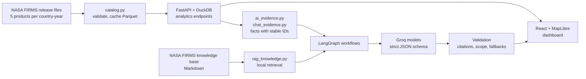
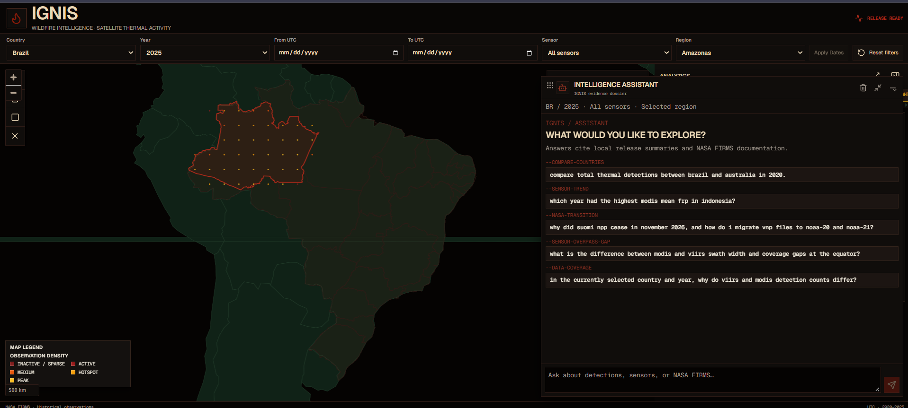

# IGNIS: Wildfire Intelligence Platform

**Sensor-aware, evidence-grounded analytics for NASA FIRMS thermal detections.**
Built for the NASA Space Apps Challenge 2026, challenge **Harmonization of MODIS and VIIRS Hot Spots**.

**Result: First place, Best Feasible Solution.**


| | |
|---|---|
| **Challenge** | Harmonization of MODIS and VIIRS Hot Spots (NASA Space Apps 2026) |
| **Local event** | Cairo |
| **Data** | NASA FIRMS active fire detections: MODIS, VIIRS Suomi NPP, VIIRS NOAA-20 |
| **Coverage** | Australia, Brazil, Indonesia, South Africa, 2020 to 2025 (24 country-years, about 38 million detections) |
| **Backend** | FastAPI, DuckDB, Parquet |
| **Frontend** | React, TypeScript, MapLibre, ECharts |
| **AI** | LangGraph workflows, Groq (`openai/gpt-oss-120b` and `openai/gpt-oss-20b`), local retrieval over a NASA FIRMS knowledge base |
| **Companion app** | Forest Guardian, a decision-oriented workspace for Mato Grosso, Brazil: https://forest-guardian-2latee.base44.app/ |
| **Demo video** ||

## Table of contents

1. [The problem](#1-the-problem)
2. [Our idea](#2-our-idea)
3. [What IGNIS does](#3-what-ignis-does)
4. [How IGNIS maps to the challenge](#4-how-ignis-maps-to-the-challenge)
5. [Architecture](#5-architecture)
6. [The data](#6-the-data)
7. [The AI layer](#7-the-ai-layer)
8. [My role: AI, insights and queries](#8-my-role-ai-insights-and-queries)
9. [Impact](#9-impact)
10. [From insights to business impact: Forest Guardian](#10-from-insights-to-business-impact-forest-guardian)
11. [Getting started](#11-getting-started)
12. [API reference](#12-api-reference)
13. [Project structure](#13-project-structure)
14. [Testing](#14-testing)
15. [Team](#15-team)

---

## 1. The problem

Satellites have tracked active fire hotspots for more than twenty years, but the record is split across instruments that cannot be compared directly. **MODIS** (on Terra and Aqua) is nearing the end of its life and is being replaced by **VIIRS**. The two differ in pixel size, sensitivity, overpass time and detection algorithm, so a raw hotspot count from one is not the same kind of number as a raw count from the other.

The result is that emergency managers, land managers and scientists cannot easily answer simple questions. Which months and years had the most burning? Is this month unusual for this area? How does the current season compare with earlier ones?

## 2. Our idea

We built one place where fire activity can be explored consistently, honestly and with a clear trail back to the source.

## 3. What IGNIS does

The interface has a map on the left and an analytics panel on the right. Everything responds to one shared selection of country, year, dates, sensor and region.

| Tab or tool | What you get |
|---|---|
| **Overview** | Total thermal detections, candidate tracks, active observation days, linked and unresolved detections, and counts per sensor. Monthly activity chart |
| **Temporal** | A daily calendar for the selected year, monthly activity and a six-year comparison with year-over-year change |
| **Spatial** | Observation density by 0.25 degree cell, top cells, and a comparison of administrative regions |
| **Sensors** | Per-sensor counts, source types and Fire Radiative Power (FRP) statistics, including monthly trends |
| **Candidate tracks** | Multi-day clusters of related detections, ranked by size, with paginated members |
| **Data quality** | Row counts, coverage reconciliation, and the engineering validation reports |
| **AI Insights** | A structured scientific report for the current selection, with every finding tied to cited evidence |
| **Export report** | A standalone HTML report with analytics and the AI interpretation |
| **Intelligence Assistant** | A chat window that answers questions from the local analytics and from a NASA FIRMS knowledge base, with citations |

The map shows aggregated density when zoomed out and individual detections when zoomed in. Users can pick an administrative region or draw a polygon.


**Example numbers (Brazil 2025, all sensors):** 1,952,261 thermal detections, split into 236,731 from MODIS, 861,621 from VIIRS Suomi NPP and 853,909 from VIIRS NOAA-20. These match an independent count of the raw NASA CSV files.

## 4. How IGNIS maps to the challenge

An honest comparison with what the challenge asked for.

| Challenge goal | Notes |
|---|---|
| Combine MODIS and VIIRS records in one consistent dataset | A unified schema with provenance for all three products |
| Web app with area selection and date range | Country, administrative region or custom polygon, plus date and sensor filters |
| Burning activity calendar  | Daily calendar, monthly activity and a six-year comparison |
| Compare with historical values | Year-over-year and month-by-year comparison across 2020 to 2025. No formal median, anomaly score or uncertainty band yet |
| Make the sensor of origin irrelevant  | We keep the sensor visible and do not apply a cross-sensor calibration. See [section 15](#15-scientific-limitations) |
| Record from the early 2000s  | The current release covers 2020 to 2025 |
| Download analytics | Standalone HTML report with the AI interpretation |
| Context beyond hotspots | The Forest Guardian companion adds NASA POWER weather and a fire-weather index for Mato Grosso (see [section 10](#10-from-insights-to-business-impact-forest-guardian)) |


## 5. Architecture



**How a release is prepared.** When the backend starts, it discovers every release folder and validates the required products and columns. It then writes small derived Parquet tables (observations, daily counts, grid cells and an overview summary) under `runtime/`. Each cache version is keyed on the source file names, sizes and modification times, so a changed release is rebuilt and an unchanged one is reused. Queries then run on those small tables, not on the raw files.

**Why DuckDB and Parquet.** The data is about 38 million rows. DuckDB reads only the columns and row groups a query needs, runs in process, and needs no database server. The default memory limit is 256 MB per connection, which is why the heavy lifting is done once, at preparation time.

## 6. The data

Each release folder (`data/releases/<Country>/<Year>/FINAL_EXPORT/`) holds five products, produced by the team's data pipeline from the NASA FIRMS archive.

| Product | What it contains |
|---|---|
| `01_FIRE_DETECTIONS.parquet` | Every NASA detection in one schema, with `source_dataset` identifying the sensor and the original `raw_` fields preserved |
| `02_FIRE_EVENTS.parquet` | Candidate multi-day activity tracks (algorithmic, not validated) |
| `03_DETECTION_EVENT_RELATIONSHIPS.parquet` | One relationship record per detection: linked to a track, unresolved, or outside tracking scope |
| `04_FIRE_ANALYTICS_FEATURES.zip` | Seven summary tables: daily and monthly activity, per-sensor views, a spatial grid and candidate features |
| `05_VALIDATION_REPORT.zip` | Data contract, quality reports and stated limitations |

**What one row means.** A row is one detected thermal pixel at one satellite overpass. It is **not** one fire. The coordinates are the center of the pixel, a long burning fire produces many rows, and one row can be an industrial heat source. That is why the app says "thermal detections" everywhere.

| Sensor | Role | Pixel size at best |
|---|---|---|
| **MODIS** (Terra and Aqua) | More than two decades of history | about 1 km |
| **VIIRS Suomi NPP** | The newer, finer instrument | about 375 m |
| **VIIRS NOAA-20** | The continuation of the VIIRS record | about 375 m |

## 7. The AI layer

The AI exists to explain the analytics, not to produce new facts. The whole design follows one rule: **the model only sees verified summaries, and everything it says must trace back to them.**

### 7.1 Principles

| Principle | How it is enforced |
|---|---|
| **No raw rows reach the model** | The model receives pre-aggregated summaries only |
| **No model-written SQL** | The backend owns every query. The model cannot ask the database anything |
| **Citations are checked** | Insights use a strict schema where each citation must be one of the real fact IDs. The assistant removes any citation that was not supplied |
| **Scientific limits are in the prompt** | The model is told that detections are thermal anomalies, that candidate tracks are unvalidated, and that it must not infer burned area, causes, spread, risk or current conditions |

### 7.2 AI Insights (structured report)

1. The user presses **Generate AI Insights** for the current selection.
2. `ai_evidence.py` builds an **evidence package** by reusing the same analytics the dashboard uses: overview, temporal, spatial, sensors, tracks and the six-year comparison.
3. The package is checked for consistency. The linked, unresolved and outside-scope counts must add up to the total, or the report is refused.
4. The package contains **13 facts with stable IDs**, for example `overview.activity`, `temporal.highest_months`, `sensors.monthly_frp`, `spatial.highest_cells`, `tracks.top_ranked` and `comparison.annual`, plus the scope and a list of ten limitations.
5. A three-node LangGraph workflow runs: `prepare`, `generate`, `validate`.
6. Groq generates the report with a strict JSON schema at temperature 0. Each key finding and recommended action must give one primary evidence ID from an enumerated list of real IDs.
7. The validator rejects any report with missing or unknown references, then attaches the cited facts to the response, so the interface can show the evidence behind each statement.

The report covers a summary, temporal, spatial, sensor, track and year-comparison analysis, data quality, key findings, cautious recommended actions, limitations and a conclusion. Results are cached per unique scope and release version, and the hourly generation limit is configurable.

### 7.3 Intelligence Assistant (chat)



A floating chat window answers free-text questions about the data and about NASA FIRMS. One question passes through a four-stage LangGraph workflow:

| Stage | What happens |
|---|---|
| **`route_and_extract`** | A small model (`openai/gpt-oss-20b`) reads the question and recent history and returns structured intent: which countries, which years, which sensor, whether sensors are being compared, and whether the question needs analytics, documentation, or both. Values are filtered through allow-lists |
| **`gather_evidence`** | The backend collects only summary facts for the requested scopes, one at a time, and retrieves up to three relevant sections from the knowledge base when documentation is needed |
| **`generate_answer`** | The main model (`openai/gpt-oss-120b`) writes a short Markdown answer from the supplied facts and sections only, with citations and up to three follow-up questions |
| **`validate_output`** | Citations that were not supplied are removed, an empty or invalid answer gets a safe fallback, and an all-unavailable result is reported plainly |

**Three kinds of question, three paths.** The starter prompts in the interface show them:

| Example question | Path |
|---|---|
| "Compare total thermal detections between Brazil and Australia in 2020" | Analytics: the router extracts two countries and one year, the backend gathers each country's summary |
| "Which year had the highest MODIS mean FRP in Indonesia?" | Analytics with a sensor: all years are requested, the MODIS summary is gathered per year |
| "Why did Suomi NPP cease in November 2026, and how do ..." | Documentation: the answer is built from retrieved NASA FIRMS knowledge sections |

**Summary-only evidence.** `chat_evidence.py` builds facts such as `BR.2020.overview`, `BR.2020.overview.MODIS` and `BR.2020.comparison`. It calls the same cached analytics the dashboard uses, so the chat and the screen agree. It queries one country and year at a time, so a cross-country question cannot flood the database with parallel queries. If the user has a region, polygon or date range selected, the facts are still full-year country summaries, and the assistant states that in a **scope note** so it never implies a filter was applied when it was not.

**Local knowledge retrieval.** `rag_knowledge.py` reads Markdown from `docs/knowledge_base/`, splits it at second and third level headings into sections with stable IDs, and ranks them for a question with a lightweight lexical score that weighs rare terms more heavily. It needs no embedding model and no downloads, returns at most three sections, and reloads automatically when the file changes. The knowledge base is a curated summary of NASA FIRMS documentation.

**The interface.** The assistant lives in `frontend/src/AiChat.tsx`. It has a launcher, compact and expanded sizes, drag-to-resize, minimize, clear chat, five starter prompts, Markdown rendering, expandable evidence for every citation and clickable follow-up questions. The Markdown renderer loads only when the first answer appears, so the dashboard stays fast.

**Guardrails in one table**

| Guardrail | Prevents |
|---|---|
| Backend-owned queries | Arbitrary SQL and raw-row access through chat |
| Sequential evidence gathering | Parallel query pressure on DuckDB memory |
| Explicit unavailable facts | A missing release aborting a whole answer, or another year being silently substituted |
| Citation allow-lists | Invented evidence IDs appearing as clickable sources |
| Scientific rules in the prompt | Claims about confirmed fires, burned area, causes, spread or risk |
| Scope notes | Answers that imply a map or date filter was honored when it was not |
| Separate chat lock and hourly limit | Chat traffic blocking report generation |
| 45 second timeout, no retries | Long or repeated external calls |

## 8. My role: AI, insights and queries

I was responsible for the AI part of the project, from the evidence that the models see to the chat window the user types into, and for the analytical queries that feed both.

### 8.1 What I worked on

| Area | What I did | Where |
|---|---|---|
| **AI Insights** | Designed the evidence package with stable fact IDs, the report schema with enumerated citations, the prompt and its scientific rules, the validation step, and the caching and rate limiting | `backend/app/ai_evidence.py`, `backend/app/ai_insights.py` |
| **Intelligence Assistant** | Built the four-stage chat workflow, the structured router, the answer policy and the citation validation | `backend/app/ai_chat.py` |
| **Chat evidence** | Wrote the summary-only fact builder, with sequential querying, unavailable-release facts and scope notes | `backend/app/chat_evidence.py` |
| **Knowledge retrieval** | Wrote a dependency-free, heading-aware retriever over the NASA FIRMS knowledge base | `backend/app/rag_knowledge.py`, `docs/knowledge_base/` |
| **API** | Added `POST /api/chat` with validated request models, a dedicated lock, an hourly limit and error mapping | `backend/app/main.py` |
| **Analytical queries** | Added mean FRP and FRP sample counts to the overview metrics, and migrated old caches in place | `backend/app/catalog.py` |
| **Chat interface** | Built the floating assistant widget and its styling | `frontend/src/AiChat.tsx`, `frontend/src/styles.css` |
| **Tests** | Wrote the chat tests and repaired the shared test fixture | `backend/tests/test_chat.py`, `backend/tests/fixtures.py` |

### 8.2 How the AI Insights evidence is built

The hard part of a grounded AI is deciding what to show it. I reused the dashboard's own queries instead of writing new ones. Then I turned their output into small, named facts:

- **Temporal:** daily counts are rolled up into monthly totals, the seven busiest days and the four busiest months.
- **Sensors:** per-sensor counts, mean and percentile FRP, brightness, source types, and a **monthly mean FRP weighted by the number of valid samples**, so a month with few measurements does not distort the trend.
- **Spatial:** the top 0.25 degree cells, converted to cell centers.
- **Tracks:** the top ranked tracks, plus a distribution of observed days, with an explicit warning that it covers only the returned top tracks and not all tracks.
- **Comparison:** annual totals, detections per calendar day and year-over-year change, using full calendar years.
- **Quality:** release version, status, and whether the calendar came from a validated archive.

Before anything reaches the model, the package must reconcile (linked plus unresolved plus outside scope equals the total) and stay under a size limit. I would rather refuse to generate a report than send inconsistent evidence.

### 8.3 How the assistant avoids making things up

I treated hallucination as a design problem, not a prompt problem. The model never touches the database, so it cannot invent a query result. It receives facts with IDs and must cite them, and the backend removes any citation that was not in the supplied context. The router's output is constrained to a schema and filtered through allow-lists, so a malformed answer from the model cannot select an unsupported country or year. When the evidence is missing, the answer says so.

### 8.4 The analytical queries

- **Mean FRP in the overview.** I extended the overview metrics with the mean FRP and the number of valid FRP measurements, using only finite values. This lets the assistant answer FRP questions from a cached summary and not from a heavy query.
- **Cache migration.** The release caches already existed, and rebuilding all of them just to add two columns would have been slow. I added a revision marker and a migration that recomputes only the small overview summary, writes it to a temporary file, and swaps it in once it is complete.
- **Sensor-aware facts.** When a sensor is requested, the assistant first checks the sensor count in the all-sensor summary and only runs the sensor-filtered query when that count is nonzero. For a sensor with no detections it returns zeros directly, which avoids an expensive fallback query.
- **Cross-year comparisons.** Multi-year questions reuse the year-comparison function, one country at a time.

### 8.5 Problems I ran into

| Problem | What I did |
|---|---|
| Several countries and years in one question could overload DuckDB's small memory budget | Gather facts sequentially through the existing connection pool, and map a busy service to a clear 503 |
| The existing tests failed because the shared fixture had no `relationship_status` column, which the loader requires | Updated the fixture, so the suite runs against realistic data |
| Old caches had no FRP columns | In-place migration of only the overview summary, staged and then swapped |
| The region comparison failed on points that match no region | Configured the Arrow function to allow intentional null outputs |
| A question about a missing release would have returned a 404 for the whole answer | Return an explicit "unavailable" fact for that scope and answer the rest |
| The model could cite evidence that was not supplied | Strict schema with enumerated IDs for reports, and citation allow-lists for chat |
| Chat answers could disagree with an active map or date filter | Scope notes that say plainly what was and was not applied |
| Local runs could not find the Groq key | Load the repository `.env` relative to the source file, and declare `python-dotenv` and `pytz` as dependencies |


## 9. Impact

**Who it is for.** Early warning and emergency teams, land and fire managers, researchers, and anyone who needs to understand historical fire activity without becoming a remote sensing specialist.

**Decisions it supports**

- Which months and years had the most thermal activity in an area, and where inside it?
- How does one year compare with the others, per sensor?
- Which candidate tracks persist across several days and may deserve closer verification?
- Where are the limits of the data, so that nobody over-interprets it?

**Why it is useful beyond the demo**

| Property | Why it matters |
|---|---|
| **Traceability** | Every number can be followed back to a release file, and every AI statement to a cited fact |
| **Honest limits** | The platform states what a detection is and is not, which protects users from over-interpretation |
| **Feasibility** | It runs on a single machine with a small memory budget and a free-tier language model, so a small agency or university group could deploy it |
| **Accessibility** | The AI turns dense analytics into plain-language explanations, and the knowledge base explains the satellite terms |
| **Reproducibility** | Immutable cached releases and a documented data contract make results repeatable |

We do not claim measured real-world impact. What we offer is a foundation that makes historical fire data easier to read and harder to misread. The next section shows how a teammate carried the same data toward decisions.

## 10. From insights to business impact: Forest Guardian

IGNIS answers **what was detected, where and when**, across four countries, with an AI that explains it. A teammate extended the solution toward **decisions** with **Forest Guardian**, a companion web app that focuses on one region, **Mato Grosso, Brazil**, and adds weather context, a fire-weather index and scenario testing on top of the same NASA data.

**Live app:** https://forest-guardian-2latee.base44.app/ (the page title reads "Forest Guardian 360"; the tagline is "Saving fire data before it's too late")

[ADD SCREENSHOT: save a capture as `docs/images/forest-guardian.png` and replace this line with ``]

### 10.1 At a glance

| | |
|---|---|
| **Region** | Mato Grosso, Brazil |
| **Window** | 1 November 2025 to 31 October 2026 |
| **Detections** | 12,470 in total: 3,258 from MODIS (`MODIS_SP`, Terra and Aqua, 1 km pixels) and 9,212 from VIIRS Suomi NPP (`VIIRS_SNPP`, 375 m pixels) |
| **Weather** | NASA POWER daily meteorology, 455 weather days. The panel shows the last 30 days of the window: temperature, relative humidity, wind speed and precipitation |
| **Fire-weather index** | Canadian Forest Fire Weather Index (FWI) System, computed from the NASA POWER days. Latest value 0.1 ("Low") on 31 October 2026 |
| **Exports** | CSV of detections and fire weather |

### 10.2 What it adds

| Page | What it gives a user |
|---|---|
| **Command Center** | A "digital twin" summary of the region's fire regime: detections per sensor, recent weather, the fire-weather gauge, recent signals and a provenance panel that says what each number represents |
| **3D Living Forest** | A three-dimensional view with a hotspot cloud, nodes and camera presets, for explaining the situation to people who do not read dashboards |
| **Compare MODIS vs VIIRS** | Sensor counts and a detection timeline side by side, which keeps the sensor difference visible |
| **Observation timeline** | Risk, station and observation events in time order |
| **What-if scenario** | Lets the user shift temperature, humidity and wind to see how the fire-weather index responds to a hotter, drier day |
| **Export analytics** | A CSV of detections and fire weather, so partners can continue the analysis in their own tools |
| **IGNIS network** | A system page for the sensors behind the data |

### 10.3 How the two apps fit together

| | IGNIS | Forest Guardian |
|---|---|---|
| **Question** | What was detected, and how do years and sensors compare? | What is the weather context, and how might conditions change? |
| **Scope** | Four countries, 2020 to 2025, 24 country-years | One region, one year |
| **Strength** | Traceable evidence, six-year comparison, cited AI explanations | Weather context, scenario testing, 3D communication, CSV export |
| **Audience** | Analysts, researchers, planners | Managers and stakeholders who need a quick, shared picture |


### 10.4 Business and decision value

These are the intended uses. We have not measured outcomes, and we do not claim pilot users or revenue.

| Possible user | How it could help |
|---|---|
| **Land and forest managers** | A single workspace that combines detections, weather and a fire-weather index for monitoring priorities and briefings |
| **Conservation organizations and municipalities** | A clear, shareable picture for communication, planning discussions and reporting |
| **Agribusiness and other landholders** | Regional context and scenario thinking to support preparedness conversations |
| **Analysts and partners** | CSV export to join the data with their own sources |

## 11. Getting started

### Data layout

Place each release in `data/releases/<Country>/<Year>/FINAL_EXPORT/`, using the exact country folders `Australia`, `Brazil`, `Indonesia` and `South_Africa`. Every release needs all five products listed in [section 6](#6-the-data). Partial installation is supported: missing years appear as unavailable, and an incomplete release is listed as invalid.

### Configuration

Copy `.env.example` to `.env` and set your key. The data is **not** included in this repository.

| Variable | Default | Purpose |
|---|---|---|
| `GROQ_API_KEY` | none | Required for AI Insights and the assistant |
| `GROQ_MODEL` | `openai/gpt-oss-120b` | Model for reports and chat answers |
| `GROQ_CHAT_ROUTER_MODEL` | `openai/gpt-oss-20b` | Model for question routing |
| `GROQ_REASONING_EFFORT` | `medium` | Reasoning level for reports |
| `AI_REPORTS_PER_HOUR` | `6` | New AI reports allowed per hour |
| `AI_CHAT_PER_HOUR` | `30` | Chat requests allowed per hour |
| `DUCKDB_MEMORY` | `256MB` | Memory limit per DuckDB connection |
| `QUERY_CONCURRENCY` | `2` | Simultaneous analytical queries |
| `PORT` | `3000` | Frontend port |

### Run with Docker

```sh
docker compose up --build
```

Open `http://localhost:3000`. The app shows preparation progress while it processes releases. After adding releases, run `docker compose restart backend`.

### Run locally

Backend:

```sh
cd backend
python3 -m venv .venv
source .venv/bin/activate
python -m pip install -r requirements.txt
uvicorn app.main:app --port 8000
```

Frontend, in a second terminal:

```sh
cd frontend
npm ci
npm run dev
```

To prepare releases without starting the server, run `python -m app.cli prepare-data` from `backend/`. Interactive API documentation is at `http://localhost:8000/docs`.

## 12. API reference

| Method | Endpoint | Purpose |
|---|---|---|
| `GET` | `/api/health`, `/api/datasets` | Preparation status and release list |
| `GET` | `/api/countries`, `/api/years`, `/api/regions` | Selection options and region geometry |
| `POST` | `/api/analytics/{kind}` | `overview`, `calendar`, `temporal`, `spatial`, `sensors` or `tracks` for a selection |
| `POST` | `/api/analytics/year-comparison` | Six-year comparison with year-over-year change |
| `POST` | `/api/analytics/regions` | Counts per administrative region |
| `POST` | `/api/map/{layer}` | `detections`, `density` or `tracks` for the current viewport |
| `GET` | `/api/detections/{id}`, `/api/tracks/{id}` | Detail for one detection or candidate track |
| `GET` | `/api/quality`, `/api/quality/report` | Coverage and validation reports |
| `POST` | `/api/ai/insights` | Generate the cited AI report |
| `POST` | `/api/chat` | One turn of the Intelligence Assistant |
| `POST` | `/api/reports/html` | Download the standalone HTML report |

**Chat request body**

```json
{
  "message": "Compare total thermal detections between Brazil and Australia in 2020",
  "history": [{ "role": "user", "content": "..." }],
  "current_filters": { "country": "BR", "year": 2025, "sensor": null }
}
```

The response contains the answer, the analytical and knowledge citations that survived validation, the facts and sections behind them, scope notes and up to three suggested follow-up questions.

## 13. Project structure

```
ignis/
  backend/
    app/
      main.py             FastAPI app, filters, analytics, chat and report endpoints
      catalog.py          release discovery, validation and cached Parquet tables
      boundaries.py       administrative boundary loading
      ai_evidence.py      evidence package for AI Insights
      ai_insights.py      LangGraph workflow for the structured report
      ai_chat.py          four-stage LangGraph workflow for the assistant
      chat_evidence.py    summary-only facts for chat
      rag_knowledge.py    local retrieval over the knowledge base
      report_export.py    standalone HTML report
      cli.py              prepare-data and fetch-boundaries commands
    tests/                unit tests, fixtures, benchmark, browser check
  frontend/src/
    App.tsx               layout and shared filters
    Analytics.tsx         dashboard tabs
    ExplorerMap.tsx       map, drawing and layers
    AiInsights.tsx        AI report view
    AiChat.tsx            floating assistant
    ExportReport.tsx      report export
  docs/
    knowledge_base/       NASA FIRMS knowledge used by the assistant
    images/               screenshots
    performance.md        benchmark notes
    boundary-attribution.md
  assets/boundaries/      packed administrative geometry per country
  docker-compose.yml
  .env.example
```

## 14. Testing

```sh
cd backend
python -m pip install -r requirements-dev.txt
python -m unittest discover -v

cd ../frontend
npm ci
npm run build
```

The backend tests cover the API, ingestion with incremental reuse, evidence gathering for several countries and years, unavailable releases, mean FRP from a prepared release, knowledge retrieval, citation validation and the mapping of upstream errors to HTTP statuses. The frontend build runs the TypeScript check and the production bundle.

For release acceptance, install Australia 2022 and check that the API reports 1,791,533 detections (160,278 MODIS, 826,535 VIIRS NOAA-20, 804,720 VIIRS Suomi NPP) and 3,326 source candidate tracks.

Live model calls need a valid `GROQ_API_KEY`. The automated tests do not call Groq.


## 15. Team

| Name | Role |
|---|---|
| **Haneen Mohammed Mousa** | AI engineering: AI Insights, Intelligence Assistant, knowledge retrieval and analytical queries |
| [ADD NAME] | [ADD ROLE] |
| [ADD NAME] | [ADD ROLE, for example the Forest Guardian business-impact app] |

